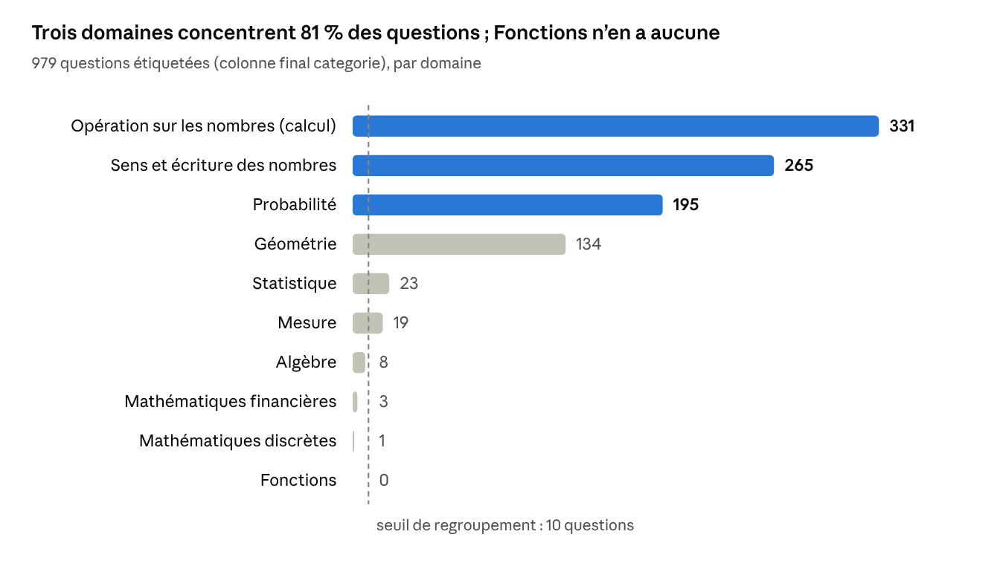
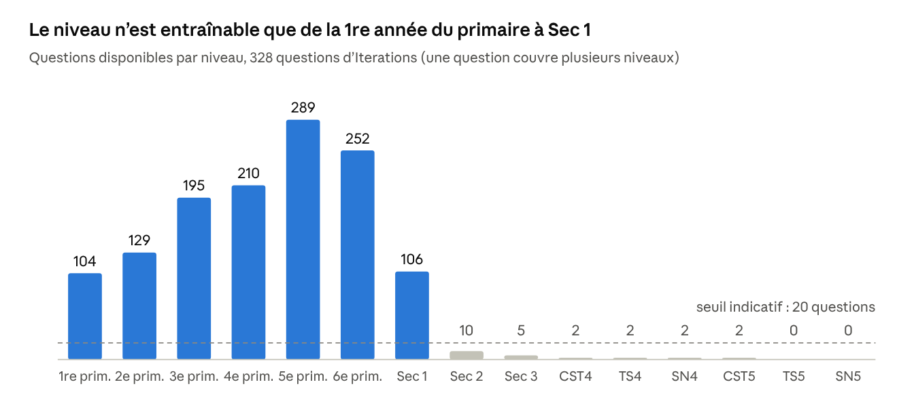
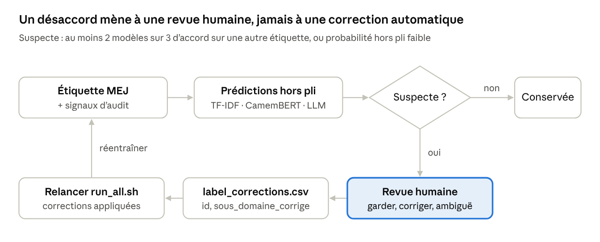

# Guide de préparation des données — Classification des questions Math en Jeu

9 octobre 2026 · Christian Nebot · version vivante : guide Claude Docs (privé)

**Version 2.** Toutes les décisions ouvertes sont tranchées (section Décisions prises). 273 étiquettes « Nombres entiers » sont recalées sur la convention du programme québécois (étape 3 bis), et le code est versionné dans un dépôt Git privé, `mej-classification-questions`. Les chiffres ci-dessous sont ceux du pipeline corrigé.

## Vue d'ensemble

L'objectif est de transformer les 981 questions Math en Jeu (MEJ) en **une table maîtresse unique, propre et versionnée**. Les jeux d'entraînement des trois familles de modèles (TF-IDF + régression logistique, CamemBERT/XLM-R, LLM) et la file de revue humaine en sont tous dérivés. Une ligne = une question. Chaque décision de nettoyage est tracée dans une colonne, jamais appliquée en silence.

| Tâche | Type de problème | Étiquette source | Questions étiquetées | Difficulté principale |
| --- | --- | --- | --- | --- |
| Domaine | Multiclasse (9 classes observées sur 10) | `final categorie` (base) ou `group_id` (plateforme) | 979 | 3 domaines = 81 % des questions |
| Sous-domaine | Multiclasse (38 classes observées sur 59) | `final sous_categorie` ou `keyword_id` | 979 | 44 % de désaccord entre les deux sources |
| Niveau scolaire | Multi-étiquette (13 niveaux observés + « niveau général ») | `availability` (Iterations\_v2) | 328 | Primaire seulement, aucune question avec image |
| Complexité | Ordinale, à définir | Aucune | 0 | L'étiquette doit être créée |

Le pipeline tient en neuf étapes, chacune produisant un fichier relu par la suivante :

- **Étape 1 — Charger** les sources brutes sans perte (encodage, champs multilignes, textes corrompus).
- **Étape 2 — Explorer** : distributions, longueurs, langues, images.
- **Étape 3 — Auditer les étiquettes** : désaccords, exactitude, doublons, cohérence avec le programme.
- **Étape 3 bis — Résoudre les étiquettes** par règle de convention (naturels / entiers).
- **Étape 4 — Nettoyer le texte** : marqueurs, LaTeX, variantes d'entrée.
- **Étape 5 — Construire les cibles** : regroupements, intervalle de niveaux, complexité.
- **Étape 6 — Découper** en train / validation / test sans fuite.
- **Étape 7 — Exporter** un format par modèle.
- **Évaluer** et générer la file de revue humaine.

Les scripts des étapes 1 à 7 sont dans le dossier Patrice, sous `prep/` (annexe en fin de guide). Tous les chiffres de ce guide en sont issus.

## Sources de données

Deux fichiers portent tout l'entraînement : **Full\_database** (texte + domaine/sous-domaine) et **Iterations\_v2** (niveaux + variantes). Ils se joignent sans perte sur `e` = `question_id`. Les 328 questions d'Iterations sont exactement les 328 questions sans image de la base.

| Fichier | Lignes | Clé | Colonnes à garder | Colonnes à écarter | Rôle |
| --- | --- | --- | --- | --- | --- |
| Full\_database.csv | 981 | `e` | `IMAGE`, `LIEN FR`, `Enonce_regex_FR`, `Enonce_regex_EN`, `Enonce_FR` (pour le type et la bonne réponse), `exactitude FR/EN`, `categorie FR`, `sous_categorie FR`, `final categorie`, `final sous_categorie` | `tokenized_*` (tokens GPT, inutiles ailleurs), les 18 colonnes de niveaux (vides), `* check` (toujours VRAI), `* EN num` | Corpus principal |
| Iterations\_v2.csv | 328 | `question_id` | `availability`, `group_id`, `keyword_id`, `FR`, `EN`, `VARIATIONS_FR`, `VARIATIONS` | `IMAGE` (toujours Non) | Niveaux, étiquettes plateforme, augmentation |
| Domaines et sous-domaines.csv | 59 FR + 59 EN | code `d.s` | Toutes | — | Référentiel des classes |
| Descriptions des niveaux (2 PDF) | 15 niveaux | nom du niveau | Texte intégral | — | Prompt du LLM, grille de complexité |
| questions\_generees\_fr.xlsx | 756 | aucune | `Niveau`, `Question`, options, `Réponse Correcte` | `Matière` (97 libellés libres) | Test hors distribution éventuel |
| questions\_mathematiques\_bilingues.csv | 150 | aucune | — | Tout | À écarter |

Trois faits changent la façon de fusionner :

- **Iterations complète la base.** Elle fournit le texte anglais de 172 questions qui n'en ont pas dans Full\_database, et le texte français de 5 questions (212, 213, 1493, 2867, 3694).
- **`Enonce_FR` brut garde des informations que `Enonce_regex_FR` a perdues** : le type de question et la position de la bonne réponse (`isRight=1`). Les types : 768 choix multiples, 108 réponses courtes, 57 vrai/faux, 1 choix multiple à 5 options.
- **Les questions avec image ne le disent presque jamais.** Seules 10,6 % d'entre elles contiennent un mot comme « figure » ou « ci-dessous ». Il faut donc garder la colonne `IMAGE` comme variable d'analyse, pas la deviner depuis le texte.

## Étape 1 — Chargement robuste

Le script `01_load.py` lit les sources sans perte et produit `master_raw` : **981 questions, toutes avec du texte**. 942 ont du français, 742 de l'anglais, et **39 n'existent qu'en anglais**. Ces 39 questions sont concentrées dans les domaines rares (12 des 23 questions de Statistique). Un modèle entraîné uniquement sur le français perdrait donc la moitié d'une classe déjà minuscule.

**Pièges de lecture à connaître :**

- **Encodage UTF-8 avec BOM et séparateur `;`.** Sans `encoding="utf-8-sig"`, la première colonne s'appelle `e` et la jointure échoue sans erreur.
- **Champs multilignes.** `wc -l` annonce 17 133 lignes pour 981 questions. Seul un parseur CSV réel (pandas) les reconstitue. Ne jamais découper ces fichiers ligne par ligne.
- **Codes lus comme des nombres.** `final categorie` mélange `3` et `3.0`. Pire, un code `3.10` lu en float devient `3.1`, qui est un autre sous-domaine. Tout est lu en `dtype=str`, puis normalisé par `norm_code()`.
- **Taxonomie fautive.** En français, « Angles » porte le code 4.2, déjà pris par « Temps ». Le script le corrige en 4.3, comme dans la version anglaise.
- **`keyword_id` tronqué à 64 caractères** dans Iterations. La correspondance vers les codes se fait sur les 60 premiers caractères.

**Textes corrompus.** Quatre textes ne sont pas des questions mais des messages d'erreur du serveur MEJ (`ENOENT`, fichier introuvable) : questions 456, 518, 550 et 2867. `01_load.py` les traite comme manquants. Les questions 518 et 550 gardent leur texte anglais ; 456 et 2867 n'ont plus aucun texte et sortent à l'étape 5.

**Fusion :** la base sert de référence et Iterations la complète (`fillna`). Une colonne `text_fr_source` / `text_en_source` garde l'origine de chaque texte. Le type de question et la position de la bonne réponse sont extraits du texte brut (`isRight=1`), avec l'anglais en repli. Les trois jeux d'étiquettes sont conservés côte à côte : `*_base` (colonnes `final_*`), `*_plat` (plateforme) et `*_orig_fr` / `*_orig_en`.

```python
def read_semicolon_csv(path):
    return pd.read_csv(path, sep=";", encoding="utf-8-sig", dtype=str)

def norm_code(x):            # '3.0' -> '3', '3.10' reste '3.10'
    s = str(x).strip()
    return s[:-2] if re.fullmatch(r"\d+\.0", s) else (s or None)
```

Les descriptions des 15 niveaux sont extraites des PDF (`pypdf`, avec `pdftotext` en repli) dans `level_descriptions.json`. Elles serviront au prompt du LLM et à la grille de complexité.

## Étape 2 — Analyse exploratoire

Le corpus est **petit, court et très déséquilibré** : 981 questions, un énoncé médian de 11 mots, et quatre domaines sous le seuil de 10 questions. `02_eda.py` produit ces chiffres, trois figures (`reports/figures/`) et `reports/eda_summary.txt`.



Le reste de l'exploration change la façon de construire les entrées :

- **Énoncés très courts.** Médiane de 11 mots (Q1 = 7, Q3 = 21). Probabilité monte à 31 mots, Opérations descend à 9. Avec si peu de texte, les choix de réponse portent une part du signal : ils doivent faire partie de l'entrée.
- **LaTeX dans 54 % des questions** (`\frac`, `\times`, `\(` … `\)`). Sans normalisation, TF-IDF et CamemBERT découpent ces commandes en bruit (étape 4).
- **Formats hétérogènes.** 776 questions à 4 choix, 108 réponses courtes (1 seule réponse affichée), 57 vrai/faux, 33 à 3 choix. Les vrai/faux sont presque tous en Sens des nombres (46 sur 57) : le type de question devient un indice du domaine.
- **Images inégales selon le domaine.** 87 % des questions de Géométrie et de Statistique s'appuient sur une image, contre 56 % en Sens des nombres. Les erreurs du modèle texte se concentreront là.
- **Sous-domaines :** 38 utilisés sur 59. Seuls 11 ont au moins 30 questions, 16 en ont moins de 5.
- **Une incohérence de hiérarchie :** la question 508 a le sous-domaine 2.3 mais le domaine 1.

Ce que je regarde systématiquement, et que le script calcule : distribution des classes, longueur par classe, couverture FR/EN par classe, part d'images par classe, type de question par classe.

## Étape 3 — Audit des étiquettes

**414 questions sur 981 (42 %) portent au moins un signal d'étiquette douteuse.** `03_audit_labels.py` les signale dans `reports/label_audit.csv` (une colonne `flag_*` par règle) sans rien corriger. Le principe de l'axe Validation s'applique dès maintenant : un signal envoie la question en revue, il ne la déclare pas fausse.

Une précision d'abord sur l'origine des étiquettes. Les colonnes `final_*` de Full\_database ne sont pas une révision indépendante. Elles reprennent l'étiquette française, avec l'anglaise en repli (identique dans 99,9 % des cas). Il existe donc deux sources réelles : **la base** (`final_*`) et **la plateforme** (`group_id` / `keyword_id` d'Iterations).

| Signal | Règle | Questions | Lecture |
| --- | --- | --- | --- |
| Entiers sans nombre négatif | Sous-domaine 1.2 ou 2.3, aucun nombre négatif en FR ni en EN | 273 | Seules 6 des 279 questions « Nombres entiers » (2,2 %) contiennent un négatif ; la plateforme n'emploie cette étiquette qu'une fois sur 326 |
| Base ≠ plateforme (sous-domaine) | `sub_base` ≠ `sub_plat` | 142 | 56,4 % d'accord sur 326 questions ; 121 désaccords sont 1.1 → 1.2 et 2.1 → 2.3 |
| Quasi-doublons aux étiquettes différentes | Cosinus ≥ 0,85 (n-grammes de caractères), sous-domaines différents dans le groupe | 122 | Une même série d'exercices est classée dans plusieurs sous-domaines |
| Exactitude FAUX | `exactitude FR` ou `EN` = FAUX | 43 | Contenu mathématique erroné : à exclure de l'entraînement |
| FR ≠ EN | Sous-domaine FR ≠ sous-domaine EN pour la même question | 37 | 7,2 % des 512 questions bilingues |
| Entiers avant le 3e cycle | Sous-domaine 1.2 ou 2.3, niveau maximal ≤ 4e année | 13 | Contraire au programme : les entiers relatifs arrivent au 3e cycle |
| Base ≠ plateforme (domaine) | `dom_base` ≠ `dom_plat` | 12 | 96,3 % d'accord : le domaine est fiable |
| Sans étiquette | `final categorie` vide | 2 | Hors entraînement |
| Hiérarchie | Préfixe du sous-domaine ≠ domaine | 1 | Question 508 |

Le détecteur de nombres négatifs exige un signe moins collé au chiffre (« -10 », « (-4) ») ou un vocabulaire explicite (« négatif », « sous zéro »). Ainsi « 35 - 4 » reste une soustraction. Cette version plus stricte ramène de 21 à 6 les questions « entiers » qui contiennent vraiment un négatif.

**Le cas le plus parlant est une série de 5 questions** (37 à 41) : « Au comptoir postal… 100 timbres par feuille. Si tu veux acheter N timbres… ». Seul N change, et pourtant la série est répartie entre quatre sous-domaines : 2.1, 2.3 (deux fois), 2.4 et même 3.1 (figures planes). Ce genre de bruit plafonne la performance de n'importe quel modèle. Il faut le traiter avant d'entraîner, pas après.

**Les quasi-doublons sont aussi un risque de fuite.** 405 questions (41 %) appartiennent à 108 familles de gabarits, la plus grande en compte 42. Le seuil de 0,85 est volontairement prudent : il regroupe aussi les questions qui partagent un même scénario mais posent une autre question (1 et 2, « loterie chanceuse », similarité 0,91). Un découpage aléatoire met des quasi-copies en train et en test, et le score obtenu est gonflé. Le numéro de famille (`dup_cluster`) sert donc de groupe à l'étape 6.

**Règles d'audit réutilisables :**

1. Comparer chaque paire de sources d'étiquettes et lister les paires de confusion (`audit_confusion_sous_domaines.csv`).
2. Poser des règles de bon sens par classe : un nombre négatif pour « entiers », une fraction ou un % pour 1.3 / 2.4, un mot de probabilité pour le domaine 5.
3. Grouper les quasi-doublons, puis vérifier l'homogénéité des étiquettes dans chaque groupe.
4. Contrôler la hiérarchie domaine / sous-domaine et les valeurs manquantes.

## Étape 3 bis — Résolution des étiquettes par convention

`04b_resolve_labels.py` **recale 273 questions de « Nombres entiers » vers « Nombres naturels »** (1.2 → 1.1 et 2.3 → 2.1). Le domaine de la base est conservé. La règle suit la définition du programme québécois : la section « Nombres entiers » de la *Progression des apprentissages* porte sur les nombres positifs **et négatifs** ([MEQ, 2009](https://laurier.cssdm.gouv.qc.ca/files/PDA_PFEQ_mathematique-primaire_2009.pdf)). Une question sans nombre négatif relève donc des naturels.

Chaque correction enregistre ses preuves indépendantes :

| Preuves | Corrections | Statut |
| --- | --- | --- |
| Texte seul (aucun négatif) | 152 | 147 avec image : `a_verifier`, un négatif pourrait être dans l'image |
| Texte + plateforme (Iterations dit déjà « naturels ») | 108 | Confirmé |
| Texte + plateforme + programme (niveau max ≤ 4e année) | 13 | Confirmé |

Trois garde-fous rendent ce choix réversible :

- L'étiquette d'origine reste dans la table (`sub_base`), avec `label_correction_rule`.
- Une correction manuelle (`data/label_corrections.csv`) l'emporte toujours sur une correction automatique.
- Les 147 cas `a_verifier` sont en tête de la file de revue.

**Effet mesuré :** sur la baseline de contrôle, l'exactitude du sous-domaine passe de 0,646 à 0,757, et les erreurs de 286 à 198. Le détail est à l'évaluation.

## Étape 4 — Nettoyage et normalisation du texte

`04_clean_text.py` découpe chaque question en énoncé, choix et explication, convertit le LaTeX en texte lisible, puis produit **trois variantes d'entrée**. Après conversion, il ne reste aucune commande LaTeX. J'utiliserais par défaut `x_stem_choices` et garderais les deux autres pour des ablations.

| Variante | Contenu | Mots (médiane / max) | Usage |
| --- | --- | --- | --- |
| `x_stem` | Énoncé seul | 11 / 78 | Ablation : que vaut l'énoncé seul ? |
| `x_stem_choices` | Énoncé + `[CHOIX]` + choix séparés par `;` | 21 / 136 | **Défaut** pour TF-IDF et CamemBERT |
| `x_full` | Ajoute `[EXPLICATION]` + explication | 57 / 266 | Ablation. Seulement si l'explication existe aussi au moment de la prédiction |
| `llm_text_fr` | Texte brut, LaTeX intact | — | LLM, qui lit le LaTeX nativement |

**Conversion LaTeX** (fonction `latex_to_text`) :

| Avant | Après |
| --- | --- |
| `\(\frac{1}{12}\)` | `1/12` |
| `3 \times 4`, `12 \div 3` | `3 × 4`, `12 ÷ 3` |
| `\sqrt{25}`, `x^{2}` | `√(25)`, `x^2` |
| `45 \ \square \ 32` | `45 □ 32` |
| `\bf`, `\mathbf{x}`, `\left(` | supprimés, contenu gardé |

Le préfixe d'explication « La bonne réponse est (A) : » est retiré. Il répète le même gabarit partout et révèle la position de la réponse.

**Ce que je ne fais pas, volontairement :**

- **Pas de mise en minuscules pour CamemBERT** : le modèle est sensible à la casse. TF-IDF met en minuscules de lui-même.
- **Pas de suppression des nombres.** Leur ordre de grandeur (jusqu'à 1 000, puis 100 000, puis 1 000 000) est exactement ce qui distingue les niveaux du primaire dans les descriptions officielles.
- **Pas de mots vides retirés ni de lemmatisation** pour les transformeurs. Pour TF-IDF, c'est une ablation à tester, pas un défaut.

**Langue.** 938 questions ont un texte principal en français, 43 seulement en anglais. Trois options, par ordre de préférence :

1. Un modèle multilingue (XLM-R) sur le mélange FR/EN.
2. Traduire les 43 questions vers le français avec un LLM, et les marquer `translated=True`.
3. Les retirer. Je le déconseille : on perdrait la moitié de Statistique.

**Variantes LLM d'Iterations.** 1 863 variantes sont analysées (930 FR, 933 EN) pour 311 questions, dans une table séparée `variations`. Le parseur gère les deux formats rencontrés (`VARIATION 1` et `### VARIATION 1`). Comme elles sont générées par un LLM, je relirais un échantillon d'une trentaine avant usage. Il faut vérifier que le concept, donc l'étiquette, est conservé.

Deux questions n'ont plus d'énoncé après le retrait des textes corrompus (456 et 2867, catégorie « Concours », sans étiquette). Elles sortent d'elles-mêmes à l'étape 5.

## Étape 5 — Construction des cibles

`05_build_targets.py` retient **936 questions éligibles**. Il en exclut 43 au contenu inexact et 2 sans étiquette, qui restent dans la table avec leur `exclude_reason`. Le domaine passe à 7 classes et le sous-domaine de 38 à 17 classes. Le niveau devient un **intervalle** \[min, max\] plutôt que 14 étiquettes indépendantes. La complexité reçoit un proxy provisoire et un protocole d'annotation.

**Domaine et sous-domaine.** La règle est la même pour les deux : sous 10 questions éligibles, une classe est regroupée (`MIN_CLASS_COUNT` dans `common.py`).

- Domaine : Algèbre (8), Mathématiques financières (3) et discrètes (1) forment `AUTRE` (12). Il reste 2 (315), 1 (253), 5 (185), 3 (130), 6 (23), 4 (18), AUTRE (12).
- Sous-domaine : une classe rare rejoint d'abord le reste de son domaine (`2.x`, `3.x`, `5.x`, `6.x`), puis `AUTRE` si ce reste est encore sous le seuil. Après l'étape 3 bis, on obtient 17 classes, de 194 questions (1.1) à 11 (6.5).
- Le préfixe de `y_sub_grp` reste cohérent avec `y_domain_grp`. Cela autorise un modèle hiérarchique : d'abord le domaine, puis le sous-domaine à l'intérieur.
- La source d'étiquettes se règle avec `LABEL_SOURCE` (`"base"` ou `"plateforme"`). Les deux jeux restent dans la table.

**Niveau : 100 % des ensembles de niveaux sont contigus.** Une question qui couvre la 3e et la 5e année couvre toujours la 4e. Chaque ensemble est donc un intervalle sur l'axe 1re primaire → Sec 5, et seules 26 combinaisons existent. Deux cibles ordinales suffisent :

- `level_min` : en pratique 5 classes (1P : 100, 5P : 95, 3P : 67, 4P : 25, 2P : 23 ; 2 cas isolés au secondaire).
- `level_max` : en pratique 5 classes (6P : 143, S1 : 89, 5P : 34, 4P : 22, 3P : 10 ; 14 cas plus rares).
- `lvl_general` (« niveau général », 58,8 %) devient un indicateur binaire à part. Les colonnes `lvl_*` (multi-hot) restent disponibles pour une baseline multi-étiquette.



Au-delà de Sec 1, Iterations compte au plus 10 questions par niveau. Aucun modèle supervisé ne prédira Sec 2 à Sec 5 à partir de MEJ. Pour ces niveaux, seuls le LLM (guidé par les descriptions officielles) ou les 747 questions synthétiques valides du fichier xlsx, en test hors distribution, peuvent servir.

**Complexité : le proxy est biaisé, il faut annoter.** Le score provisoire `cx_proxy` est une moyenne de z-scores (mots, phrases, nombres, ordre de grandeur, opérateurs) découpée en tertiles. Il classe 105 des 130 questions de Géométrie en « faible ». Ce n'est pas parce qu'elles sont simples : leur contenu est dans l'image, pas dans le texte. Le proxy mesure la longueur du texte, pas la difficulté.

Le script exporte donc `reports/annotation_complexite.csv` : 120 questions stratifiées par domaine et par tertile, à annoter par deux personnes selon cette grille :

| Niveau | Définition | Exemple type |
| --- | --- | --- |
| 1 — faible | Une seule notion, une opération, données explicites | Comparer 62 et 26 |
| 2 — moyenne | 2 ou 3 étapes, ou une conversion ou représentation intermédiaire | Probabilité simple à partir d'un tirage |
| 3 — élevée | Plusieurs notions combinées, modélisation d'une situation, information à extraire | Dénombrer puis calculer une probabilité composée |

**Décision D3 : complexité absolue, évaluée sur 120 questions annotées.** J'ai annoté l'échantillon selon cette grille (`annotations/complexite_annotateur1.csv`) : 67 questions de niveau 1, 46 de niveau 2, 7 de niveau 3.

- Le proxy textuel ne s'accorde qu'à **κ = 0,22** (kappa pondéré quadratique) avec cette annotation. Il est donc rejeté comme cible.
- La complexité de toutes les questions est demandée au LLM (axe 3) et évaluée contre ces 120 références (`cx_gold`).
- Le niveau 3 est rare (6 %). Pour un classifieur supervisé, je recommande une cible binaire : une étape (1) contre plusieurs étapes (2 et 3).
- Une deuxième annotation (`complexite_annotateur2.csv`) sera prise en compte automatiquement, en moyenne arrondie. L'accord se mesurera alors avec le même kappa, en visant au moins 0,6.

## Étape 6 — Découpage sans fuite

`06_split.py` gèle un **test de 125 questions (13,4 %)** et répartit les 811 autres en 5 plis de validation croisée (141 à 204 questions par pli ; le pli le plus gros contient la famille de 42 quasi-doublons). Aucune famille ne traverse deux partitions. Les 7 domaines et les 17 sous-domaines regroupés sont tous présents dans le test.

**Trois règles, toutes vérifiées par le script :**

1. **Grouper par famille de gabarits.** `StratifiedGroupKFold` avec `groups = dup_cluster` (étape 3). Sans ce groupement, les séries de type « Au comptoir postal… » se répartissent entre train et test, et le modèle est noté sur des questions qu'il a déjà vues.
2. **Un seul découpage pour toutes les tâches.** Une question de test l'est pour le domaine, le sous-domaine et le niveau. Sinon, un modèle multi-tâche apprendrait sur une tâche ce qu'on lui demande de prédire sur une autre.
3. **Les variantes héritent de la partition de leur question d'origine.** En validation croisée, quand le pli *k* sert à valider, les variantes des questions de ce pli sortent de l'entraînement. C'est la fuite la plus facile à commettre avec Iterations.

**Stratification.** La clé combine le sous-domaine regroupé et une tranche de `level_min` (1P–2P, 3P, 4P–5P, 6P et plus). Le script essaie 100 graines et garde le découpage dont les distributions de domaine et de sous-domaine collent le mieux au corpus. Toute classe absente du test est fortement pénalisée. Résultat : moins de 2 points d'écart par domaine, et 270 questions en train contre 42 en test pour le niveau.

**Ce que ce découpage implique pour l'évaluation :**

- Avec 125 questions, le test contient 3 questions de Mesure, 3 de Statistique et 1 `AUTRE`. Le macro-F1 du test est donc bruité. Je choisirais modèles et hyperparamètres sur la moyenne ± écart-type des 5 plis, et je n'ouvrirais le test qu'une fois, à la fin, avec un intervalle de confiance par bootstrap.
- La part de questions avec image est équilibrée (66,4 % en test, 66,7 % en train). Les scores doivent quand même être rapportés séparément pour `has_image`, car c'est là que les erreurs se concentreront.

## Étape 7 — Formats de sortie par modèle

`07_export.py` écrit un export par famille de modèles dans `prep/data/processed/`. Tous partagent les mêmes `id`, partitions et plis, ce qui permet de comparer les trois approches sur exactement les mêmes questions.

| Fichier | Contenu | Pour |
| --- | --- | --- |
| `questions_master.parquet` / `.csv` | 981 lignes × 81 colonnes : textes, 3 jeux d'étiquettes, corrections, cibles, variables, partition, signaux d'audit | Référence et analyses |
| `tfidf/train.csv`, `tfidf/test.csv` | 811 / 125 questions, les 3 variantes d'entrée, toutes les cibles, `fold` | Axe 1 |
| `hf/train.jsonl`, `hf/test.jsonl`, `hf/label2id.json` | Texte `x_stem_choices`, étiquettes entières, niveaux, `fold` | Axe 2 |
| `hf/augment_train.jsonl` | 1 533 variantes FR/EN de questions de train uniquement, avec le `fold` de leur source | Axe 2 (augmentation) |
| `llm/system_prompt_fr.txt`, `llm/output_schema.json` | Taxonomie complète, 15 descriptions de niveaux, grille de complexité, schéma JSON | Axe 3 |
| `llm/test.jsonl`, `llm/fewshot_pool.jsonl` | 125 questions de test (LaTeX intact) ; 34 exemples few-shot (2 par sous-domaine, sans aucun signal d'audit) | Axe 3 |
| `ood/xlsx_niveaux.jsonl` | 747 questions synthétiques sur les 15 niveaux (après retrait de 9 lignes corrompues) | Test hors distribution, Sec 2 à Sec 5 |
| `review/review_queue.csv` | 414 questions signalées, les 147 corrections à vérifier en tête ; colonnes `decision` et `sous_domaine_corrige` à remplir | Axe 4 |

**Axe 1 — TF-IDF + régression logistique.** J'unirais des n-grammes de mots (1–2) et de caractères (2–5). Ces derniers capturent les fragments mathématiques comme `1/12` ou `×`. J'ajouterais `class_weight="balanced"` et j'utiliserais la colonne `fold` pour la validation croisée :

```python
tr = pd.read_csv("prep/data/processed/tfidf/train.csv", dtype={"y_sub_grp": str})
feats = make_union(TfidfVectorizer(ngram_range=(1, 2), min_df=2, sublinear_tf=True),
                   TfidfVectorizer(analyzer="char_wb", ngram_range=(2, 5), min_df=2, sublinear_tf=True))
clf = make_pipeline(feats, LogisticRegression(C=5, class_weight="balanced", max_iter=3000))
for k in range(5):
    a, b = tr[tr.fold != k], tr[tr.fold == k]
    clf.fit(a.x_stem_choices, a.y_sub_grp); pred = clf.predict(b.x_stem_choices)
```

**Axe 2 — CamemBERT ou XLM-R.** RoBERTa est entraîné sur l'anglais. CamemBERT est son équivalent français. XLM-R permet d'utiliser aussi les 43 questions anglaises et les variantes anglaises. Repères de départ :

- `max_length=256` suffit : l'entrée la plus longue fait 136 mots.
- Pour le pli *k* : entraînement sur `fold != k`, plus les lignes d'`augment_train.jsonl` dont `fold != k` ; validation sur `fold == k`.
- Taux d'apprentissage 2e-5, 5 à 10 époques, arrêt anticipé sur le macro-F1 de validation, pertes pondérées par classe.
- Une tête multi-tâche (domaine + sous-domaine) est possible, puisque le découpage est commun.
- Avec environ 800 exemples, je ferais 3 graines par configuration : la variance d'un pli à l'autre (± 0,05 à 0,08 de macro-F1 sur la baseline) dépasse souvent l'écart entre deux modèles.

**Axe 3 — LLM zero-shot ou few-shot.** Le prompt système (environ 10 000 caractères) contient la taxonomie complète des 59 sous-domaines et les descriptions officielles des 15 niveaux. C'est ce qui permet au LLM de couvrir Sec 2 à Sec 5, que les modèles supervisés ignorent. Pour que la comparaison soit honnête :

- Modèle figé (décision D6) : l'instantané daté gpt-4o-2024-08-06 pour honorer le « GPT 4.0 » du plan. Vérifier sa disponibilité avant de lancer, et noter le modèle et la date dans chaque résultat.
- Température 0 et sortie JSON contrainte par `output_schema.json`.
- Le LLM prédit les 59 sous-domaines bruts. Pour le comparer aux modèles supervisés, ramener sa sortie sur les 17 classes regroupées avec `label_maps.json`.
- Few-shot : piocher dans `fewshot_pool.jsonl`, jamais dans le test. Les exemples viennent de questions sans aucun signal d'audit, pour ne pas enseigner le bruit au modèle.

## Évaluation et revue humaine

Une baseline de contrôle (`08_smoke_baseline.py`, environ 40 secondes) confirme que les exports fonctionnent tels quels. Elle fixe aussi le plancher à battre après la correction de l'étape 3 bis : **macro-F1 de 0,67 pour le domaine et de 0,64 pour le sous-domaine** en validation croisée. Le test n'a pas été ouvert.

| Tâche (entrée `x_stem_choices`) | Avant correction | Après correction | Repère |
| --- | --- | --- | --- |
| Domaine, macro-F1 | 0,646 ± 0,076 | 0,669 ± 0,081 | Classe majoritaire : exactitude 0,334 |
| Domaine, exactitude | 0,851 | 0,844 |  |
| Sous-domaine, macro-F1 | 0,576 ± 0,066 | 0,636 ± 0,049 | Classe majoritaire : exactitude 0,208 |
| Sous-domaine, exactitude | 0,646 | 0,757 | 18 classes avant, 17 après |
| Niveau min, exactitude / erreur moyenne | 0,676 / 0,64 an | 0,669 / 0,65 an |  |
| Niveau max, exactitude / erreur moyenne | 0,560 / 0,68 an | 0,558 / 0,66 an |  |

Les autres variantes d'entrée sont dans `reports/smoke_baseline*.csv`. Après correction, `x_stem_choices` est la meilleure entrée pour le sous-domaine (0,636 contre 0,584 pour l'énoncé seul et 0,560 avec l'explication).

**La correction a retiré la première source d'erreur.** Avant, 41 % des erreurs de sous-domaine (116 sur 286) étaient des confusions entre 1.1, 1.2, 2.1 et 2.3. Après, il reste 198 erreurs sur 811 questions. Les confusions dominantes sont désormais des frontières de domaine : 1.1 ↔ 2.1 (27 cas, « sens » ou « opérations » sur les naturels) et 1.3 ↔ 2.4 (18 cas, même ambiguïté pour les fractions). C'est la prochaine frontière à clarifier dans la consigne d'annotation.

**Métriques par tâche :**

| Tâche | Métrique principale | Compléments |
| --- | --- | --- |
| Domaine, sous-domaine | Macro-F1 | Exactitude, F1 par classe, matrice de confusion |
| Niveau | Erreur absolue moyenne (en années) sur `level_min` et `level_max` | Intervalle exact, Jaccard sur les ensembles de niveaux |
| Complexité | Kappa pondéré quadratique contre l'annotation humaine | Corrélation de Spearman |
| LLM, en plus | Taux de JSON valide | Coût et latence par question |

Chaque score est rapporté trois fois : sur l'ensemble, selon `has_image` (oui / non), et sur les questions sans aucun signal d'audit. Si l'écart entre « propres » et « signalées » est grand, le plafond vient des étiquettes et non du modèle.

**Axe 4 — Validation, la boucle complète :**

1. **Prédictions hors pli.** En validation croisée, chaque question de train reçoit une prédiction d'un modèle qui ne l'a jamais vue. On obtient ainsi une prédiction honnête pour les 811 questions de train, pas seulement pour les 125 du test.
2. **Score de suspicion par question.** Il combine trois éléments : le nombre de modèles (TF-IDF, CamemBERT, LLM) en désaccord avec l'étiquette MEJ, la probabilité hors pli de cette étiquette (faible = suspecte, principe du *confident learning*, bibliothèque `cleanlab`), et les signaux d'audit.
3. **Priorité haute** quand au moins 2 modèles sur 3 s'accordent sur la même autre étiquette.
4. **Revue humaine** dans `review/review_queue.csv` (déjà préremplie avec les 414 questions signalées). Décision : garder, corriger ou ambiguë. Une question ambiguë peut légitimement relever de deux sous-domaines.
5. **Réintégration.** Les corrections vont dans `prep/data/label_corrections.csv` (`id`, `sous_domaine_corrige`). `05_build_targets.py` les applique automatiquement, puis on relance `run_all.sh`. L'étiquette d'origine reste dans la table et `label_corrected` trace la modification.



La règle du plan est respectée de bout en bout : un désaccord envoie la question en revue, il ne la déclare jamais fausse automatiquement.

## Décisions prises

Patrice n'ayant pas pu trancher, **j'ai pris les neuf décisions à partir des données, du programme québécois et de sources publiques**. Chacune est réversible : un paramètre dans `common.py` ou un fichier de corrections suffit. Le détail, avec preuves et sources, est dans `docs/DECISIONS.md` du dépôt.

| # | Question | Décision | Preuve principale |
| --- | --- | --- | --- |
| D1 | Source d'étiquettes | La base (`final_*`), corrigée par D2 | 979 questions couvertes contre 326 ; 96,3 % d'accord sur le domaine |
| D2 | Naturels / entiers | Convention du programme : entiers = positifs et négatifs ; 273 questions recalées | 6 « entiers » sur 279 contiennent un négatif ; plateforme : 1 sur 326 ; [Progression des apprentissages](https://laurier.cssdm.gouv.qc.ca/files/PDA_PFEQ_mathematique-primaire_2009.pdf) |
| D3 | Complexité | Absolue, grille à 3 niveaux, 120 questions de référence ; prédite par le LLM | Proxy textuel : κ = 0,22 seulement |
| D4 | Niveaux des questions avec image | Entraînement et évaluation sur les 312 questions texte ; prédictions non évaluées ailleurs | Les pages publiques MEJ n'affichent pas de niveau ([exemple](https://mathenjeu.ca/question/1?lg=fr)) |
| D5 | Fichiers synthétiques | xlsx = test hors distribution (747 questions) ; bilingue écarté | Seule source Sec 2–Sec 5 ; bilingue : 48 bonnes réponses absentes des choix |
| D6 | « GPT 4.0 » | `gpt-4o-2024-08-06`, température 0, sortie JSON | Retraits de février 2026 limités à ChatGPT et à `chatgpt-4o-latest` ([OpenAI](https://help.openai.com/en/articles/20001051-retiring-gpt-4o-and-other-chatgpt-models), [VentureBeat](https://venturebeat.com/ai/openai-is-ending-api-access-to-fan-favorite-gpt-4o-model-in-february-2026)) |
| D7 | Transformeur | XLM-R base en principal, CamemBERT en comparaison | 43 questions et 933 variantes en anglais |
| D8 | Livrable et données | Dépôt Git privé ; données MEJ non versionnées | Le texte des questions appartient à MEJ |
| D9 | Textes corrompus | 4 messages d'erreur serveur traités comme manquants | Questions 456, 518, 550, 2867 |

**Ce qu'il reste à faire :**

- [ ] Cloner le dépôt, déposer les fichiers bruts dans `data/raw/` et lancer `./run_all.sh`
- [ ] Faire relire les 147 corrections `a_verifier` (questions avec image) en tête de `review_queue.csv`
- [ ] Faire une deuxième annotation de complexité sur les 120 questions, puis calculer le kappa
- [ ] Relire 30 variantes LLM pour vérifier que le concept est conservé
- [ ] Entraîner l'axe 1, puis 2 (XLM-R), puis 3 (gpt-4o), sur les mêmes plis
- [ ] Ouvrir le test une seule fois, à la fin

## Annexe — Scripts et arborescence

Le pipeline est un dépôt Git autonome, `mej-classification-questions` (dossier `Patrice/prep/` sur le poste). Il se rejoue en une commande, en moins d'une minute, et ne modifie jamais les fichiers bruts.

```bash
git clone https://github.com/Me710/mej-classification-questions.git
cd mej-classification-questions
pip install -r requirements.txt   # pandas, pyarrow, scikit-learn, openpyxl, pypdf, matplotlib
export MEJ_RAW_DIR=~/Documents/Patrice   # ou copier les fichiers bruts dans data/raw/
./run_all.sh                      # étapes 01 à 08
```

| Script | Rôle | Sorties principales |
| --- | --- | --- |
| `common.py` | Chemins, paramètres, regex partagées | — |
| `01_load.py` | Chargement sans perte, fusion, textes corrompus | `data/interim/master_raw` |
| `02_eda.py` | Analyse exploratoire | `reports/eda_*`, `reports/figures/*.png` |
| `03_audit_labels.py` | Audit des étiquettes, quasi-doublons, contrôle programme | `reports/label_audit.csv`, `data/interim/dup_clusters` |
| `04_clean_text.py` | Énoncé / choix / explication, LaTeX → texte, variantes | `data/interim/text_clean`, `variations` |
| `04b_resolve_labels.py` | Corrections par convention naturels / entiers | `data/label_corrections_auto.csv` |
| `05_build_targets.py` | Cibles, variables, complexité de référence | `data/interim/targets` |
| `06_split.py` | Train / test + 5 plis groupés | `data/interim/splits` |
| `07_export.py` | Exports par modèle, test hors distribution, file de revue | `data/processed/` |
| `08_smoke_baseline.py` | Baseline de contrôle | `reports/smoke_baseline.csv` |

Paramètres réglables dans `common.py` : `LABEL_SOURCE` ("base"), `MIN_CLASS_COUNT` (10), `DEDUP_THRESHOLD` (0,85), `TEST_SIZE` (0,15), `N_FOLDS` (5), `SEED` (42). Les données MEJ (`data/raw/`, `data/interim/`, `data/processed/`) ne sont pas versionnées.

```text
mej-classification-questions/
├── 01_load.py … 08_smoke_baseline.py, 04b_resolve_labels.py, common.py, run_all.sh
├── annotations/          complexite_annotateur1.csv (id + niveau 1–3)
├── data/
│   ├── raw/              fichiers MEJ (non versionnés, voir README)
│   ├── label_corrections_auto.csv   corrections de l'étape 3 bis
│   ├── label_corrections.csv        corrections manuelles (à créer après la revue)
│   ├── interim/          tables de travail (non versionnées)
│   └── processed/        tfidf/, hf/, llm/, ood/, review/, questions_master (non versionnés)
├── docs/                 DECISIONS.md, GUIDE.md
└── reports/              eda_*, audit_*, label_audit.csv, smoke_baseline*.csv, figures/
```
